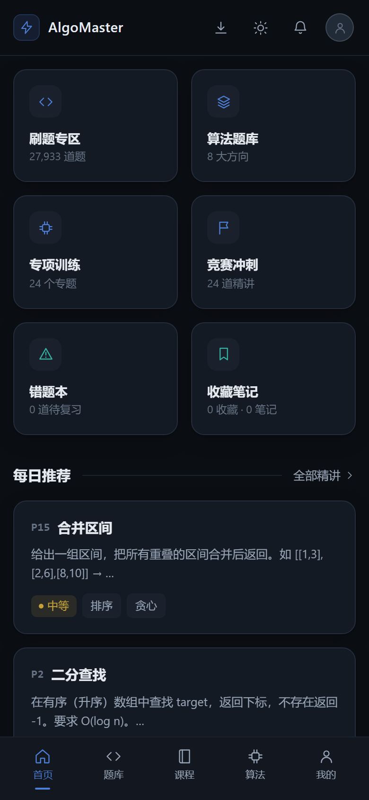
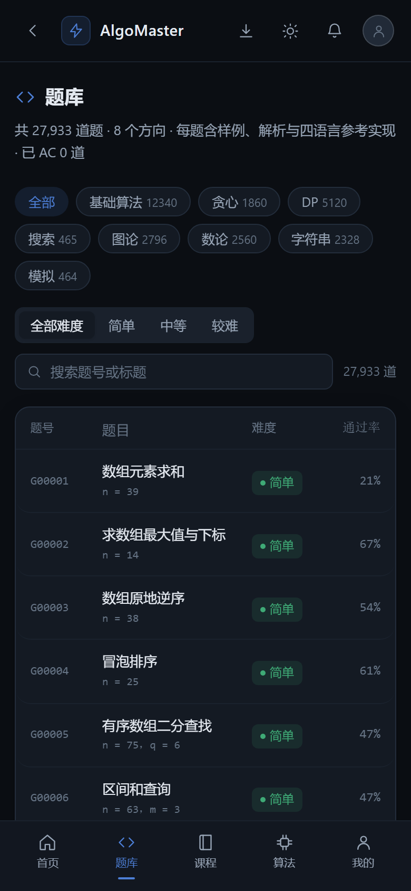
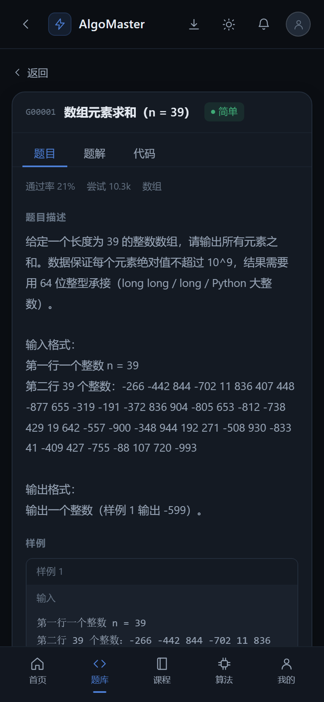
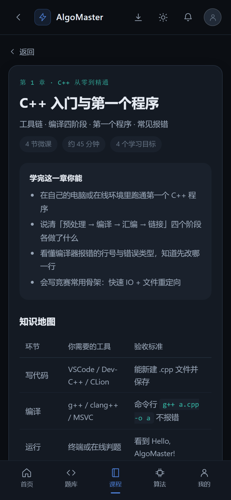

# AlgoMaster · 算法刷题

一个**零依赖、纯静态**的算法刷题应用：题库 + 题解 + 多语言课程 + 算法专题 + 面试题库，既能当网页用（PWA 可安装），也能打成**离线可用的安卓 APK**。

> 没有框架、没有 bundler、没有后端。所有内容由 Node 脚本生成，前端是原生 JS + 纯 CSS 变量主题。



## 内容规模

| 内容 | 数量 |
| --- | --- |
| 题库 | 27,933 道（按题型 / 难度 / 关键词检索，40 条一页） |
| 题解 | 27,933 份（思路 + 复杂度 + C++/Python/Java/C 四语言参考代码） |
| 语言课程 | 4 门 × 20 章 × 4 节微课 = 80 章 / 320 节 |
| 算法专题 | 24 个（模板 + SVG 图解 + 例题） |
| 面试题库 | 72 组主问题 / 576 条（含追问链） |
| 静态体积 | 约 171 MB（题库分片按需懒加载） |

## 功能

- **题库**：题号 / 标题 / 题型三路搜索，空结果自动给出「实际存在的题型」推荐芯片
- **做题页**：四语言代码编辑器、AC 记录、笔记、收藏、错题本，代码块横向溢出自动提示
- **课程**：每节含 SVG 图解、代码、对照表、要点与易错点，章节 chips 快速跳转
- **专题**：复杂度曲线、DP 网格、指针演示等 12 类图元，深浅主题自适应
- **学习闭环**：每日打卡、连续天数、成就墙、头像框解锁
- **体验**：深/浅双主题、手机优先、底部 Tab、虚拟页面栈 + 物理返回键接管

| 题库 | 做题 | 课程 | 专题 |
| --- | --- | --- | --- |
|  |  |  |  |

## 快速开始

```bash
git clone https://github.com/<your-name>/algomaster.git
cd algomaster

# 生成题库分片与题解（仓库里只放源码，产物 158MB 不进版本库）
bash tools/gen-all.sh

# 起个静态服务器（任选其一）
python3 -m http.server 8080
# 或 npx serve .
```

打开 <http://localhost:8080> 即可。

> 页面本身可以正常打开，但**题库分片和题解需要先生成**，否则点击题目会 404。

## 目录结构

```
.
├── index.html            # 单页外壳 + 安装引导
├── manifest.json         # PWA 清单
├── sw.js                 # Service Worker（核心文件离线缓存）
├── css/style.css         # 全部样式（含 --fig-* 图解变量、双主题）
├── js/
│   ├── app.js            # 全部前端逻辑（约 150KB，单文件）
│   ├── data-problems.js  # 精讲题库
│   └── data-algorithms.js# 24 个算法专题正文（生成）
├── data/                 # 数据分片（懒加载）
│   ├── problems-index.js # 全量索引 [id, title, diff, type, shard]
│   ├── problems-NNN.js   # 题库分片 ×1747（生成，已 gitignore）
│   ├── sol-NNN.js        # 题解分片 ×1746（生成，已 gitignore）
│   ├── course-*.js       # 4 门语言课程
│   ├── interview-*.js    # 面试题库
│   └── manual-*.js       # 语言手册
├── android/              # 安卓外壳（原生 WebView，30 行逻辑之外都是标准 API）
│   ├── AndroidManifest.xml
│   ├── src/…/MainActivity.java
│   └── res/              # 自适应图标 + 各密度图
├── tools/                # 内容生成器 + 测试 + 打包脚本
│   ├── kb/               # 4 门语言课程知识库
│   ├── algo-kb-*.js      # 24 个专题知识库
│   ├── figs.js figmap.js # SVG 图元库与挂载表
│   ├── gen.js gen-solutions.js gen-course.js gen-algo.js
│   ├── build-apk.sh gen-all.sh
│   └── smoke.js e2e.js accept.js layout-check.js …
└── docs/screenshots/
```

## 数据生成流水线

| 脚本 | 产出 | 体积 |
| --- | --- | --- |
| `tools/gen.js` | `data/problems-NNN.js`、`problems-index.js`、`stats.js`、`types-index.js`、`interview-*.js`、`manual-*.js` | 94 MB |
| `tools/gen-solutions.js` | `data/sol-NNN.js`（每道题一份题解） | 62 MB |
| `tools/gen-course.js` | `data/course-*.js` + `course-index.js`（4 语言 × 20 章 × 4 节） | 0.8 MB |
| `tools/gen-algo.js` | `js/data-algorithms.js`（24 个专题） | 0.2 MB |

一次全跑：`bash tools/gen-all.sh`（需要 Node.js ≥ 18，几分钟）。

题面样例由每种题型的真实 solver 反算生成，保证「样例输入 → 样例输出」自洽；`data/` 下的文件都是**生成产物**，不要手改。

## 构建安卓 APK

APK 是**全量内嵌**的：所有资源打进 `assets/`，通过 `shouldInterceptRequest` 把
`https://appassets.androidplatform.net/` 映射到本地文件，因此首次打开不需要联网，断网也能用。
（对比之下，很多「套壳」方案只装一个 WebView 去加载线上地址，包只有几十 KB。）

**依赖**：JDK 17、Android SDK（build-tools + 任一 platform）、python3 或 `zip`。

```bash
bash tools/build-apk.sh              # 产物 build/algomaster.apk
bash tools/build-apk.sh /tmp/a.apk   # 指定路径
```

脚本做的事：`aapt2 compile → aapt2 link -A assets → javac → d8 → 注入 classes.dex → zipalign → apksigner`。

- 没有签名材料时会自动生成 `android/debug.keystore`（口令 `android`），**仅供本地测试**；上架请用正式证书并妥善保管
- 自己构建的包和官方 Release 签名不同，安装前请先卸载旧版
- Windows 下注意：脚本内部全部用相对路径调用 aapt2，因为 aapt2 处理不了带中文的绝对路径

## 测试

仓库带了 8 套脚本，纯 Node + 一个本地 Chrome（部分需要）：

| 脚本 | 检查内容 |
| --- | --- |
| `node tools/smoke.js` | 冒烟：全部页面渲染与核心交互（82 项，DOM 模拟，无需浏览器） |
| `node tools/accept.js` | 真实浏览器点击验收：Tab / 首页入口 / 80 章 / 24 专题 / 搜索 / AC / 返回栈（63 项） |
| `node tools/e2e.js` | 端到端交互回归（58 项） |
| `node tools/layout-check.js` | 布局与溢出、APK 壳行为（含注入假 `AndroidShell`） |
| `node tools/check-course.js` | 课程完整性：80 章 / 320 节 / 每节结构 |
| `node tools/check-solution.js` | 题解覆盖率与静态体积 |
| `node tools/check-types.js` | 题型 solver 自洽性（抽样 36,000 组） |
| `node tools/online-check.js` | 线上部署巡检 |

`accept.js` / `e2e.js` 会自己拉起 `chrome --headless` 并用 CDP 驱动，需要本机装了 Chrome 或 Edge。

## 部署

纯静态站点，扔到任何静态托管（GitHub Pages / Cloudflare Pages / Vercel / Nginx）即可，不需要构建步骤。

```bash
bash tools/gen-all.sh
# 把整个目录（除 tools/、android/、build/）发布出去即可
```

当前演示站挂在 WorkBuddy 分享网关上，所以 URL 后面带 `?sharecode=…`；**自建部署不需要这个参数**，
它只影响该网关的子资源鉴权。

## 已知限制

- 浏览器版做题页的「运行 / 提交」是**静态检查**（括号匹配、头文件、`main` 存在、常见坑），不是真编译执行；通过即记 AC
- APK 内的资源是构建时的快照，更新内容需要重新构建并重新安装
- 学习数据存在 `localStorage`，清缓存或换包名（来源域名变化）会重置

## 贡献

欢迎 issue / PR。改内容请改 `tools/` 下的知识库，然后重新跑生成脚本，不要直接改 `data/` 里的产物。

## 许可证

[MIT](LICENSE)
